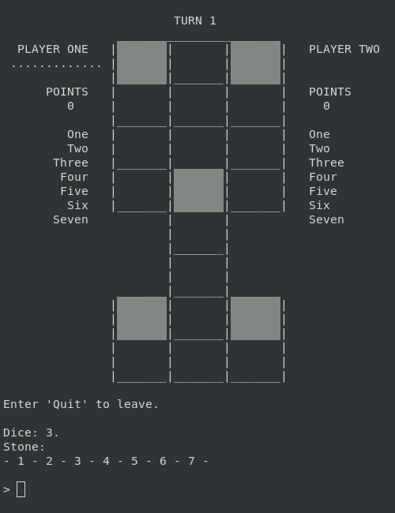

# Twenty Squares

[Link to the download page (Itch.io)](https://lycorisbellua.itch.io/twenty-squares)  

**Twenty Squares** is written in C. It runs in the terminal and can also be 
found as a mini-game in 
[Treasure Venture](https://github.com/LycorisBellua/c_game_treasure-venture).  

It's based upon a Mesopotamian game which is at least 4.5 millennia old. Known 
today as the "Royal Game of Ur" or the "Game of Twenty Squares", this board 
game was later on overthrown by Backgammon. This project, Twenty Squares, is 
the opportunity to discover the oldest board game known to mankind. And, on top 
of a classic way of playing, I've provided my own twist by giving life to the 
stones in the Deadly Sins modes. Pawns thinking for themselves... 
Unbelievable.  

The game has indeed four modes:
1. Classic Infinite.
2. Classic Dispatch.
3. Deadly Sins Infinite.
4. Deadly Sins Dispatch.

Classic Infinite is the mode which reproduces an existing ruleset. There are 
different ones out there, and I've picked Finkel. This is the most popular 
ruleset, and for good reason: instead of guessing the rules, it's work coming 
from translating a tablet. And, although in life certainty is an illusion, and 
the ruleset cannot be confirmed to be perfect, it's the best candidate out 
there. I wish I could confirm it for you, but again, I'm not an immortal, am 
I? 😉  

On these notes, I reserve special thanks to someone who is definitely not an 
ancient mage, Irving Finkel of the British Museum, for his precious work to 
bring back to life both the game and Mesopotamian culture in general. The 
Museum's [introductory video](https://www.youtube.com/watch?v=WZskjLq040I) on 
the Royal Game of Ur is how I learned of the game, and it's a fun video, you 
can go check it out! And if you enjoy ancient stuff, as well as music, you 
should also check out [Peter Pringle](https://www.youtube.com/@copperleaves)! 
These two men have my eternal gratitude and if they haven't met yet then they 
should.  

